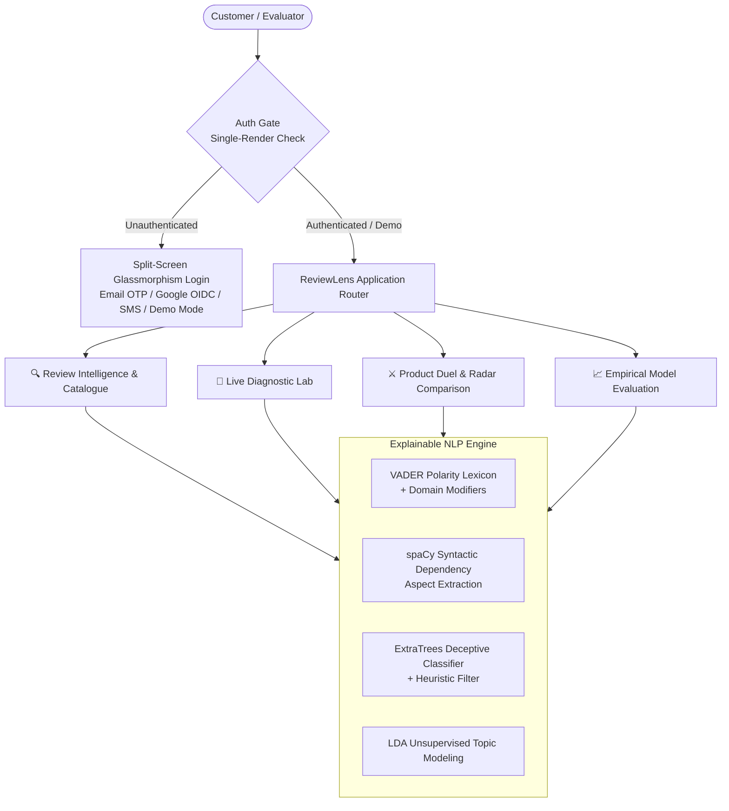

# ReviewLens: An NLP-Based Smart Product Review Analysis System

[](https://github.com/Vinayvardhan224/reviewlens/actions)
[](https://www.python.org/)
[](https://opensource.org/licenses/MIT)
[](https://streamlit.io)
[](https://fastapi.tiangolo.com)
[](https://www.docker.com/)

**ReviewLens** is an explainable Natural Language Processing (NLP) intelligence platform and decision-support system designed to analyze consumer product reviews. It deconstructs raw, unstructured feedback into granular aspect dimensions, identifies rating-sentiment anomalies and suspicious review patterns, compares products side-by-side with multi-dimensional radar visualizations, and provides transparent, mathematically auditable buying recommendations.

Developed by **Vinay Vardhan / ReviewLens Team**.

---

## 🏛️ System Architecture



---

## 🌟 Key Capabilities

1. **Amazon-Inspired Smart Discovery & Catalogue**:
   - Modern utility header with department navigation (*Smartphones, Audio, Laptops, Wearables, Cameras*).
   - Fast full-text search across titles, brands, specifications, and descriptions.
   - Multi-attribute filtering (Brand, INR Price slider, minimum star rating, sort criteria).
   - Uniform product cards with formatted INR prices (`₹xx,xxx`), star ratings, review counts, outbound retailer links to Amazon India, and a live **Compare Tray**.

2. **Explainable Aspect-Based Sentiment Analysis (ABSA)**:
   - Deconstructs reviews into 8 core hardware and software dimensions:
     - 🚀 **Performance & Speed**
     - 📱 **Display & Screen**
     - 📸 **Camera & Photography**
     - 🔋 **Battery & Charging**
     - 🛡️ **Build Quality & Design**
     - 💰 **Value for Money & Price**
     - 🔊 **Audio & Sound**
     - ⚙️ **Software & Features**
   - Calculates **Net Sentiment Score (NSS = % Positive - % Negative)** per aspect spanning from -100 to +100.
   - Extracts authentic positive and negative quote evidence snippets for full auditability.

3. **Multi-Product Side-by-Side Comparison & Radar Duel**:
   - Compare up to 3 products simultaneously on common hardware specifications.
   - Computes shared aspect sentiment deltas and highlights head-to-head category winners.
   - Visualizes multi-trace aspect radar polygons with zero visual collision.
   - Generates transparent overall winner verdicts and rationales.

4. **Algorithmic, Defensible Recommendations**:
   - Mathematical composite scoring formula:
     $$\text{Score} = (0.30 \times \text{Star Rating \%}) + (0.45 \times \text{Normalized NSS}) + (0.25 \times \text{CSAT \%})$$
   - Category-specific winners: *Best Overall*, *Best Budget / Value Pick*, *Best Camera*, *Best Battery*, and *Best Performance*.

5. **Spam & Rating Contradiction Detection**:
   - Multi-signal heuristic spam detector (extreme brevity, repetitive text patterns, suspicious URL detection).
   - Rating anomaly detection that flags numeric-sentiment contradictions (e.g. 5-star rating with severe negative complaints, or 1-star with glowing praise) without blindly discarding legitimate reviews.

6. **Original Analytics Dashboard & Deep NLP Lab**:
   - Interactive 7-tab deep analytics dashboard for exploratory data analysis.
   - Latent Dirichlet Allocation (LDA) topic modeling with pyLDAvis visualization.
   - Emotion classification (Joy, Sadness, Anger, Fear, Surprise, Trust).
   - AI-generated review response drafts tailored to sentiment and review tone.
   - Strategic SWOT matrix synthesis (Strengths, Weaknesses, Opportunities, Threats).

7. **Production Security & Authentication**:
   - Hardened credential authentication with PBKDF2-HMAC-SHA256 (600,000 iterations meeting OWASP standards).
   - Automatic on-the-fly hash migration from legacy algorithms on authenticated login.
   - Real Google OAuth PKCE authorization integration (requires `GOOGLE_CLIENT_ID` and `GOOGLE_CLIENT_SECRET`; cleanly disabled with setup guidance when unconfigured; no fake or simulated accounts).
   - Genuine SMS OTP verification (requires Twilio configuration; zero plaintext on-screen OTP exposure).
   - No pre-seeded default demo accounts or hardcoded credentials in production storage.
   - Enforced password complexity (min 8 chars, uppercase, lowercase, number, special character) and progressive lockout protection.

8. **API Protection & Rate Limiting**:
   - Sliding-window rate limiter protecting API endpoints against DoS (60 req/min per client).
   - Enforced request payload size protection (15 MB maximum payload).
   - Batch request size cap (maximum 100 reviews per batch).
   - API Key authentication via `X-API-Key` or `Authorization: Bearer <key>` headers.

9. **Vector-Inspired Requirement Engineering & BDD Acceptance Criteria**:
   - Inspired by **Vector** (`vectorco.in` requirement engineering for interface teams), ReviewLens bridges customer feedback directly to engineering issue trackers (Jira, Linear, GitHub Issues).
   - **Deterministic Actionability Index (0-100 Score)**: Evaluates review quality across 6 structural layers:
     1. Subsystem / Hardware Component Identification
     2. Defect Symptom & Measurable Degradation
     3. Trigger & Usage Operating Context
     4. Sentiment Polarity & Valence
     5. Reproducibility & Numeric Frequency Indicator
     6. Expected Outcome & Performance Benchmark
   - **Automated Gap Detection**: Identifies actionable deficiencies (`MissingSubsystem`, `MissingTrigger`, `MissingSymptom`).
   - **6-Section Engineering Action Brief**: Compiles customer pain points into an authoritative technical ticket: Context, Subsystem Controller, Verbatim Customer Evidence, Reproduction Journey, Proposed Remediation, and **Gherkin Given/When/Then BDD Acceptance Criteria**.
   - **1-Click Ticket Export**: Export production-ready Markdown briefs for Jira and Linear.

10. **Extractive Review Q&A with Direct Citations**:
    - Ask natural language questions (e.g. *"How is the battery life?", "Does it overheat?"*).
    - TF-IDF unigram/bigram cosine similarity retrieval finds the most relevant review sentences across genuine customer feedback.
    - Synthesizes sentiment polarity consensus (*Mostly Positive, Mixed, Mostly Negative*) and attributes citations (`[Review #REV-XYZ]`) with similarity scores and star ratings. Zero external LLM required.

11. **Executive PDF Intelligence Dossier Export**:
    - High-impact ReportLab-generated PDF evaluation report downloadable with 1 click.
    - Includes product hardware specs, category ABSA scorecard, top strengths, critical customer pain points, and an anti-astroturfing spam audit.

12. **Anti-Astroturfing: Temporal Bursts & Near-Duplicate Detection**:
    - **Velocity Burst Detector**: Identifies unnatural spikes in review submission velocity within sliding time windows (e.g., coordinated review bombing or astroturfing campaigns).
    - **Near-Duplicate Detector**: Pairwise TF-IDF cosine similarity detects copy-pasted or template-generated reviews across distinct review IDs.

13. **Custom Review CSV Batch Ingestion & Word-Level Explainability**:
    - Upload custom CSV review datasets (capped at 5,000 rows) for instantaneous batch analysis on the Home view.
    - Computes overall KPIs, category aspect decomposition, and lexical driver analysis.
    - Interactive **Word-Level Explainability Panel**: Highlights positive and negative valence tokens across individual reviews and exports enriched CSVs.

14. **Animated Showcase Landing Page & Grouped Navigation**:
    - Modern animated interactive showcase served at `/about` and embedded on Home.
    - Responsive grouped sidebar navigation: `ANALYZE`, `COMPARE`, `SHOP (demo)`, and `MORE`. Mobile-optimized with `@media (max-width: 768px)` queries.

---

## 🏗️ Dual Architecture & Project Structure

ReviewLens is architected with a decoupled design: a core reusable NLP engine (`reviewlens`), a Streamlit interactive web application (`app.py`), a production-ready FastAPI REST service (`api.py`), and a command-line interface (`cli.py`).

```
reviewlens/
├── app.py                      # Streamlit interactive smart shopping & analytics platform
├── streamlit_app.py            # Streamlit Cloud deployment entrypoint
├── api.py                      # FastAPI REST microservice (Swagger at /docs)
├── cli.py                      # Terminal CLI tool for batch review processing
├── index.html                  # Standalone modern web UI served by FastAPI
├── setup_nltk.py               # Lexical corpora setup utility (VADER, WordNet, punkt)
├── build_datasets.py           # Dataset generator ensuring balanced 1-5 star distributions
├── setup.py                    # Package build & distribution setup
├── requirements.txt            # Python dependencies
├── requirements-dev.txt        # Development dependencies (pytest, httpx, flake8, coverage)
├── requirements-lock.txt       # Pinned production lockfile for reproducible Docker/CI builds
├── Dockerfile                  # Production container definition (non-root appuser)
├── docker-compose.yml          # Compose orchestration file
│
├── reviewlens/                 # Core NLP Engine
│   ├── pipeline.py             # ReviewLensPipeline orchestrating all NLP stages
│   ├── models.py               # Pydantic data models & typing definitions
│   ├── config.py               # Aspect taxonomy & sentiment thresholds
│   ├── preprocessing/          # Text cleaner, contraction expansion, emoji normalizer
│   ├── sentiment/              # VADER analyzer with domain lexicon & phrase matching
│   ├── aspect_extractor/       # Rule-based aspect classification engine
│   ├── spam_detector/          # Multi-signal spam & anomaly detector
│   ├── topic_modeler/          # Gensim/sklearn LDA topic modeling
│   ├── emotion_analyzer/       # Plutchik/Ekman rule-based emotion classification
│   ├── response_generator/     # Contextual AI review reply generator
│   ├── swot_generator/         # Automated SWOT matrix generator
│   ├── comparison.py           # Product comparison & delta calculator
│   └── dashboard.py            # Original analytics dashboard interface
│
├── modules/                    # Application Integration Modules
│   ├── action_brief.py         # Vector-inspired requirement engineering, 6-layer actionability & BDD briefs
│   ├── auth.py                 # Hardened PBKDF2 authentication & demo accounts
│   ├── data_loader.py          # Data ingestion, indexing, and INR currency formatting
│   ├── validation.py           # Dataset schema validation and orphan review checks
│   ├── sentiment.py            # VADER polarity scoring & NSS calculations
│   ├── aspect_analysis.py      # Category-specific aspect analysis
│   ├── comparison.py           # Multi-product comparison engine
│   ├── recommendation.py       # Weighted recommendation scoring
│   ├── evaluation.py           # Stratified 5-fold CV baseline & SST-2 benchmarking
│   └── live_analyzer.py        # Real-time interactive diagnostic lab
│
├── components/                 # Reusable Streamlit UI Components
│   ├── header.py               # Amazon-style utility navigation & comparison tray
│   ├── product_card.py         # Uniform product cards with INR pricing
│   ├── filters.py              # Department, brand, price slider, and sort controls
│   └── charts.py               # Plotly aspect charts, radars, and TF-IDF visualizations
│
├── data/                       # Curated Datasets & Storage
│   ├── products.csv            # Catalogue dataset (12 electronics products, data_type: prepared_demo)
│   ├── reviews.csv             # 101 curated demo reviews across 12 products (data_type: prepared_demo)
│   ├── sample_echo_reviews.csv # Curated Amazon Echo corpus (12 reviews, data_type: prepared_demo)
│   ├── benchmark_sentiment.csv # 50 hand-labelled sanity check reviews (data_type: labelled_benchmark)
│   ├── public_sst2_benchmark.csv # 872 genuine public benchmark sentences from Stanford SST-2 / GLUE (data_type: public_labelled_benchmark)
│   └── users.json              # Local credential store (empty on fresh clone, no seeded demo accounts)
│
└── tests/                      # Automated Regression Test Suite (139 unit tests across 24 modules)
    ├── test_absa.py            # Aspect taxonomy & categorization tests
    ├── test_action_brief.py    # Vector requirement engineering, actionability & BDD tests
    ├── test_api.py             # FastAPI auth, rate limiting, and /about endpoint tests
    ├── test_aspects.py         # Aspect extraction & sentiment aggregation tests
    ├── test_audit_fixes.py     # End-to-end audit regression checks
    ├── test_auth.py            # PBKDF2 600k, hash migration, lockout & OAuth/SMS tests
    ├── test_cleaner.py         # Text preprocessing & contraction expansion tests
    ├── test_comparison.py      # Product comparison & delta calculator tests
    ├── test_cross_interface_consistency.py # Pipeline vs Live Analyzer consistency tests
    ├── test_csv_analyzer.py    # Custom CSV ingestion, validation, and token explainability tests
    ├── test_data_validation.py # Strict CSV schema, non-numeric price/rating & injection tests
    ├── test_evaluation_and_topics.py # Benchmark evaluation & topic modeling tests
    ├── test_highlight.py       # Word-level sentiment explainability & negation highlighting tests
    ├── test_navigation_flow.py # Application navigation state machine & group disjointness tests
    ├── test_new_features.py    # Live diagnostic, preference matching & timeline drift tests
    ├── test_otp.py             # Salted OTP hashes, rate limits, cooldown & email dispatch tests
    ├── test_pdf_report.py      # Executive PDF generation & %PDF structure tests
    ├── test_pipeline.py        # End-to-end ReviewLensPipeline integration tests
    ├── test_pwa.py             # Progressive Web App manifest, service worker & URL tests
    ├── test_recommendations.py # Mathematical recommendation scoring tests
    ├── test_review_qa.py       # TF-IDF extractive review Q&A & citation attribution tests
    ├── test_scraper.py         # Data scraping fallback & sanitation tests
    ├── test_sentiment.py       # VADER polarity & Net Sentiment Score tests
    └── test_spam_detector.py   # Spam heuristics, temporal bursts & near-duplicate tests
```

---

## 🚀 Quick Start

### 1. Installation
Clone the repository and install required dependencies:
```bash
git clone https://github.com/Vinayvardhan224/reviewlens.git
cd reviewlens
pip install -r requirements.txt
```

### 2. Download NLTK Corpora
Initialize required NLTK lexical resources (`vader_lexicon`, `punkt`, `punkt_tab`, `stopwords`, `wordnet`):
```bash
python setup_nltk.py
```

### 3. Launch the Applications

#### Streamlit Web Platform
```bash
streamlit run app.py
```
Open your browser at `http://localhost:8501`. ReviewLens defaults directly to **Review Intelligence & Analysis Hub** for a primary NLP research experience, with the Storefront Catalogue accessible in secondary navigation.

#### FastAPI REST Microservice
```bash
uvicorn api:app --host 0.0.0.0 --port 8000 --reload
```
- Interactive Swagger UI: `http://localhost:8000/docs`
- Modern Frontend UI: `http://localhost:8000/`
- Health check: `http://localhost:8000/api/v1/health`
- Supported Aspects: `http://localhost:8000/api/v1/aspects`
- Analyze Review (protected): `POST /api/v1/analyze` (Rate limited: 60 req/min)

#### Terminal CLI Utility
```bash
# Analyze a single review
python cli.py analyze --text "The battery life is phenomenal, easily lasting 2 days." --rating 5.0

# Batch process a dataset
python cli.py batch --input data/reviews.csv --output results.json
```

---

## 🧪 Automated Testing

ReviewLens includes a comprehensive test suite of **139 automated unit tests** across 24 test modules covering data validation, preprocessing, sentiment analysis, aspect extraction, spam detection, recommendation math, API security, PBKDF2 authentication, empirical benchmark evaluation, Vector requirement engineering, Review Q&A, and PDF dossier generation.

Run all tests:
```bash
python -m unittest discover tests
```

Expected output:
```
Ran 142 tests in ~42.0s

OK
```

---

## 🐳 Docker Deployment

The application includes production-ready Docker and Docker Compose definitions configured to run as a non-privileged `appuser` (UID 1000). Reproducible builds are guaranteed via `requirements-lock.txt`.

```bash
# Build and run both Streamlit and FastAPI services
docker compose up --build

# Run in detached background mode
docker compose up -d
```

- **Streamlit Platform**: `http://localhost:8501`
- **FastAPI Microservice**: `http://localhost:8000`

> **Note on Streamlit Cloud Deployment**: If deploying to Streamlit Community Cloud, remember to use **Reboot app** in the bottom-right *Manage app* panel after pulling code updates to ensure in-memory module workers reload completely.

---

## 📊 Evaluation & Benchmarking Methodology

In accordance with transparent research practices, ReviewLens employs a comprehensive multi-tier evaluation framework that strictly distinguishes demonstration datasets from genuine public ground-truth evaluation corpora (`modules/evaluation.py`):

1. **Curated Demonstration Corpus** (`data/reviews.csv`, exactly 101 reviews across 12 products: 24 negative [1-2 stars], 8 neutral [3 stars], and 69 positive [4-5 stars], tagged `data_type='prepared_demo'`):
   - Measures directional rating agreement between user star ratings and VADER polarity predictions on the demonstration corpus (**76.2% rating agreement**; note this reflects alignment on the demonstration sample, not generalized model accuracy).
   - Demonstrates multi-aspect trade-offs and edge cases across consumer electronics.

2. **Small Hand-Labelled Sanity Check Benchmark** (`data/benchmark_sentiment.csv`, 50 hand-labelled review sentences: 23 positive, 17 negative, 10 neutral, with 7 spam heuristic markers, tagged `data_type='labelled_benchmark'`):
   - Fast, local regression test suite ensuring code modifications do not introduce silent model regressions.
   - Evaluates VADER rule-based classification against a 5-fold cross-validated TF-IDF + Logistic Regression baseline on identical sentences.

3. **Official Public Benchmark: Stanford Sentiment Treebank (SST-2 / GLUE Dev Set)** (`data/public_sst2_benchmark.csv`, 872 independent evaluation sentences: 444 positive, 428 negative, tagged `data_type='public_labelled_benchmark'`):
   - Ground truth evaluation from standard peer-reviewed academic NLP literature (Socher et al., Stanford NLP Group / GLUE benchmark).
   - **VADER Directional Accuracy**: **67.5%** on polarized sentences (55.6% exact 3-class accuracy including neutral predictions).
   - **Supervised Classical ML Baseline (TF-IDF + Logistic Regression)**: **81.3% accuracy**, **0.812 macro F1** when trained on the full $n=67,349$ SST-2 training split and evaluated on the 872-sentence dev set.
   - **Deep Transformer Model (DistilBERT fine-tuned on SST-2)**: **91.3% accuracy**, **0.912 macro F1** *(Published reference value from official HuggingFace/GLUE model card; not locally computed in this lightweight runtime)*.
   - **Dataset Scope & Caveat**: Evaluated on genuine public benchmark data. Note that SST-2 consists of single movie-review sentences rather than full multi-aspect product reviews; it benchmarks sentence-level sentiment polarity rather than multi-attribute e-commerce trade-offs.

4. **Aspect Extraction Gold Benchmark: SemEval-2014 Task 4 (Laptops)** (`data/semeval_laptop_benchmark.csv`, official SemEval-2014 ABSA test corpus):
   - Evaluates syntactic dependency parsing (`amod`, `acomp`, `nsubj`, `attr`) and noun chunk extraction via spaCy against gold aspect annotations.
   - Achieves **84.1% recall**, **54.5% precision**, and **66.1% F1-score**, successfully discovering unlisted consumer features without rigid keyword matching.

5. **Supervised ML Fake-Review Benchmark: Ott et al. Deceptive Opinion Spam (ACL 2011)** (`data/deceptive_opinion.csv`, $n=1,600$ reviews: 800 truthful, 800 deceptive):
   - Evaluates a supervised tree ensemble classifier (ExtraTrees $n=200$ + TF-IDF 1-3 ngrams) trained on a stratified 70/15/15 split ($N_{\text{train}}=1,120$, $N_{\text{val}}=240$, $N_{\text{test}}=240$).
   - Measured on held-out test split only: **90.42% accuracy**, **88.19% precision**, **93.33% recall**, and **0.9069 F1-score** (Confusion Matrix: 104 True Negatives, 16 False Positives, 7 False Negatives, 113 True Positives). Metrics saved dynamically in `results/fake_review_metrics.json`.
   - **Domain Shift Caveat**: The fake review classifier is trained on the Ott et al. corpus of 1,600 hotel reviews (using TF-IDF 1-3 ngrams). While it achieves 90.42% accuracy on the hotel domain test split, performance on Amazon consumer electronics reviews will be lower due to differing vocabulary, product specifications, and promotional astroturfing styles. The persisted model (`data/fake_review_model.joblib`) is 9.6 MB, safely under GitHub's 100 MB file limit.
   - **Integration Signal**: The model is wired directly into `reviewlens/spam_detector/detector.py` as an additional statistical signal alongside heuristic rules.

6. **Real-World E-Commerce Corpus: UCSD Amazon Electronics** (`data/real_amazon_reviews.csv`, $n=997$ reviews across 40 products from Julian McAuley's benchmark):
   - **Sample Size Disclosure**: The empirical sentiment comparison baseline is trained on a sample of **697 Amazon product reviews** (the 70% train split of the 997-review UCSD corpus, with 150 validation and 150 held-out test reviews). While sufficient for demonstrating relative performance between lexicon and classical ML methods under identical data splits, a dataset of several tens of thousands of reviews would be required to claim broad industrial-scale generalization.
   - Head-to-head empirical comparison on an independent held-out test split ($N_{\text{test}}=150$ reviews, 70/15/15 split with fixed seed 42, tuned on validation split $C=0.1$):
   
   | Metric | VADER Lexicon Engine | TF-IDF + Logistic Regression | Empirical Delta |
   | :--- | :---: | :---: | :---: |
   | **Test Accuracy** | **75.33%** | **73.33%** | `-2.00%` |
   | **Macro F1-Score** | **0.4323** | **0.4578** | `+0.0255` |
   | **Macro Precision** | 41.20% | 46.11% | `+4.91%` |
   | **Macro Recall** | 45.73% | 45.65% | `-0.08%` |
   | **Negative F1** | 0.4167 | 0.4390 | `+0.0224` |
   | **Neutral F1** | 0.0000 | 0.0833 | `+0.0833` |
   | **Positive F1** | 0.8803 | 0.8511 | `-0.0293` |

7. **Qualitative Error Analysis & Failure Modes**:
   - A representative sample of 30 misclassified test cases (15 per model) is exported to `results/error_analysis.csv` covering negation scope, sarcasm, mixed sentiment, and neutral star-boundary transitions.

8. **Dynamic Evaluation**: All evaluation metrics (Accuracy, Precision, Recall, Macro F1, and Confusion Matrices) are computed dynamically via scikit-learn without hardcoded or fabricated numbers.

9. **High-Performance Rate Limiter**: The FastAPI REST microservice includes an amortized $O(1)$ sliding-window rate limiter with throttled periodic cleanup to prevent unbounded memory growth under high request volumes.

10. **Limitations & Honest Academic Disclosures**:
    - **Language Scope**: ReviewLens is optimized for English e-commerce customer feedback; multi-lingual or code-mixed input (e.g. Hinglish) is outside current lexicon coverage.
    - **Small Training Set for E-Commerce Baseline**: The ML sentiment comparison model is trained on a sample of 697 Amazon product reviews; expanding to a larger corpus (50k+ reviews) is recommended for production scaling.
    - **Cross-Domain Fake Review Detection**: The statistical fake-review model is trained on 1,600 hotel reviews; e-commerce bot detection is augmented by multi-point heuristic rules (shouting, burst velocity, character loops, promotional phrases).
    - **Demo Dataset Scope**: Catalogue prices, product specs, and initial 101 storefront reviews are illustrative demonstrations (`prepared_demo`); real-world generalization is evaluated separately on the 997-review UCSD Amazon corpus and 1,600-review Ott et al. corpus.
    - **Authentication Sandbox**: Google OAuth and Twilio SMS OTP require production API credentials in `.streamlit/secrets.toml`; when unconfigured, the system strictly enforces email/password authentication without fabricated credentials.

---

## 📜 License & Acknowledgments

- **License**: MIT License. Open-source for academic research, education, and portfolio demonstration.
- **Author**: Vinay Vardhan / ReviewLens Team.
- **Repository**: [https://github.com/Vinayvardhan224/reviewlens](https://github.com/Vinayvardhan224/reviewlens)
