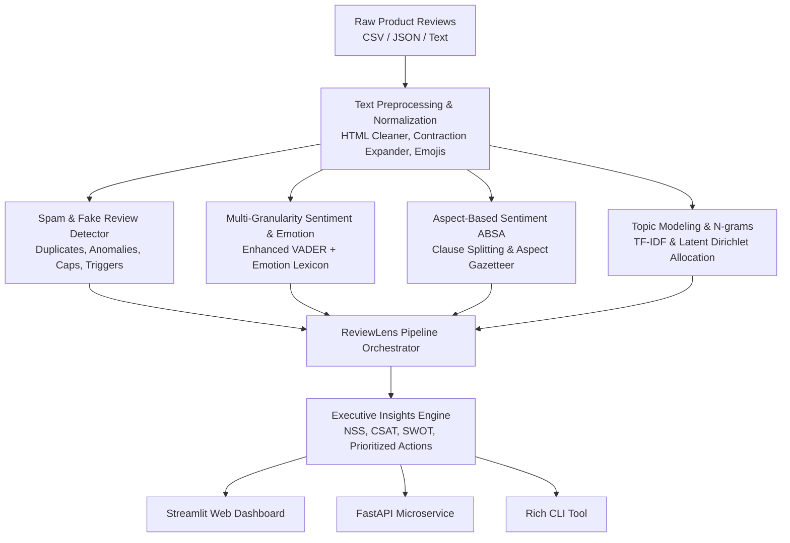

# ReviewLens: An NLP-Based Smart Product Review Analysis System

**ReviewLens** is an end-to-end Natural Language Processing (NLP) intelligence platform designed to analyze e-commerce customer reviews, extract granular aspect-based sentiment, identify fake/spam reviews, discover latent customer discussion topics, and synthesize strategic product recommendations.

---

## 🌟 Key Features

1. **Aspect-Based Sentiment Analysis (ABSA)**:
   - Breaks reviews into discrete clauses (with adversative splitting like *"X is great, but Y is terrible"*).
   - Deconstructs reviews into core dimensions: **Battery & Power**, **Sound & Audio**, **Build Quality & Durability**, **Display & Visuals**, **Comfort & Ergonomics**, **Performance & Speed**, **Price & Value**, **Ease of Use & Connectivity**, **Customer Support**, and **Packaging & Shipping**.
   - Computes aspect-specific Net Sentiment Scores (NSS) and polarity distributions.

2. **Multi-Granular Sentiment & Emotion Classification**:
   - Enhanced VADER sentiment analyzer augmented with domain-specific consumer electronics and retail lexicons.
   - 5-class psychological consumer emotion mapping (*Joy & Delight*, *Trust & Confidence*, *Frustration & Anger*, *Disappointment*, *Anticipation*).
   - Predicted star rating (1.0 to 5.0) calibration and confidence scoring.

3. **Spam, Bot & Fake Review Detection**:
   - Detects rating-sentiment contradictions (e.g. 5-star rating with severe negative complaints, or 1-star rating with promotional praise).
   - Flags promotional trigger phrases, affiliate links, and WhatsApp spam solicitation.
   - Identifies copy-paste duplicate reviews across datasets.
   - Detects excessive capitalization (shouting) and punctuation spam.

4. **Deep NLP & Unsupervised Topic Modeling**:
   - TF-IDF n-gram extraction isolating positive driver phrases vs. negative pain points.
   - Latent Dirichlet Allocation (LDA) discovering hidden thematic conversation clusters.
   - WordCloud generation.

5. **Executive Intelligence & Automated SWOT Synthesis**:
   - Calculates **Net Sentiment Score (NSS = % Pos - % Neg)** and **Customer Satisfaction Index (CSAT %)**.
   - Generates automated **SWOT analysis** (Strengths, Weaknesses, Opportunities, Threats).
   - Produces a prioritized product management & engineering action plan with designated team assignments.

6. **Triple-Interface Architecture**:
   - **Interactive Web Dashboard**: Modern Streamlit application with interactive Plotly charts, aspect drilldowns, live review tester, and dataset explorer.
   - **REST API Microservice**: FastAPI server with automatic Swagger UI (`/docs`).
   - **Rich Command-Line Interface (CLI)**: Terminal analyzer with rich tables and progress bars.

---

## 🏗️ Architecture



---

## 🚀 Quick Start Guide

### 1. Installation

Ensure Python 3.9+ is installed, then install the dependencies:

```bash
cd reviewlens
pip install -r requirements.txt
```

### 2. Launch the Streamlit Web Dashboard

```bash
streamlit run app.py
```

The interactive dashboard will open in your browser at `http://localhost:8501`.
You can select built-in datasets (including Real-World Amazon Echo Dot), scrape live reviews by ASIN, or upload your own CSV/Excel file.

### 3. Run with Docker & Docker Compose (Zero Setup)

Run the full system (Streamlit Dashboard + FastAPI microservice) in isolated containers:

```bash
docker compose up --build
```
- Streamlit Web Dashboard: 👉 `http://localhost:8501`
- FastAPI REST Microservice: 👉 `http://localhost:8000/docs`

### 4. Deploy 100% Free on Streamlit Cloud

1. Push your repository to GitHub.
2. Sign in to [share.streamlit.io](https://share.streamlit.io).
3. Click **New app** → Select your repository → Set Main file to `app.py` → Click **Deploy**!
*(All dependencies and `.streamlit/config.toml` are pre-configured for automatic deployment).*

### 5. Launch the FastAPI Microservice Locally

```bash
uvicorn api:app --reload --port 8000
```

Access the interactive API documentation and Swagger test suite at:
👉 `http://localhost:8000/docs`

### 6. Use the Command-Line Interface (CLI)

- **Run the Built-in Demo:**
  ```bash
  python cli.py demo
  ```

- **Analyze a Single Review via Terminal:**
  ```bash
  python cli.py analyze-text "The battery life is amazing and lasts 3 days, but the earcups hurt after 2 hours." --rating 4.0
  ```

- **Analyze an Entire Dataset File:**
  ```bash
  python cli.py analyze-file data/real_world_amazon_echo_reviews.csv --export output_report.json
  ```

---

## 📡 Live Amazon Review Scraper

ReviewLens includes an anti-blocking Amazon customer review scraper:

```python
from scraper.amazon_scraper import AmazonReviewScraper

scraper = AmazonReviewScraper()

# Extract reviews by ASIN or Amazon product URL
reviews = scraper.scrape_product_reviews(asin="B084DCJKSL", max_pages=2)
print(f"Scraped {len(reviews)} customer reviews!")
```
Or use the live scraper directly inside the Streamlit Web Dashboard sidebar!

---

## 💻 Python SDK Usage

You can import and use ReviewLens directly in your Python applications or data pipelines:

```python
from reviewlens import ReviewLensPipeline

pipeline = ReviewLensPipeline()

# 1. Analyze a single review
analysis = pipeline.analyze_single(
    text="The AMOLED screen is gorgeous with vibrant colors, but it gets uncomfortably hot during gaming.",
    rating=3.5
)

print(f"Sentiment: {analysis.sentiment.label} (Compound: {analysis.sentiment.compound})")
print(f"Predicted Rating: {analysis.predicted_rating} / 5.0")
print(f"Is Spam: {analysis.spam.is_spam}")

for aspect in analysis.aspects:
    print(f"Aspect: {aspect.category} | Polarity: {aspect.sentiment_label} ({aspect.sentiment_score:+.2f})")

# 2. Analyze a batch / dataset
reviews = [
    {"id": "1", "text": "Super fast charging and great display!", "rating": 5.0},
    {"id": "2", "text": "Fragile screen cracked on a tiny drop.", "rating": 1.0},
]
result = pipeline.analyze_dataset(reviews)

print(f"Net Sentiment Score: {result.executive_summary.net_sentiment_score}")
print(f"CSAT: {result.executive_summary.csat_score}%")
```

---

## 🧪 Running Unit Tests

Run the complete test suite:

```bash
python -m unittest discover tests
```

All tests for text cleaning, sentiment scoring, aspect extraction, spam detection, and the integrated pipeline will execute.

---

## 📁 Project Structure

```
reviewlens/
│
├── README.md                      # Complete system documentation & guides
├── requirements.txt               # Dependencies
├── setup.py                       # Python package configuration
├── app.py                         # Interactive Streamlit Web Dashboard
├── cli.py                         # Rich Command-Line Interface tool
├── api.py                         # FastAPI REST microservice
│
├── reviewlens/                    # Core library package
│   ├── __init__.py                # Public exports
│   ├── config.py                  # Aspect taxonomy, lexicon, and spam rules
│   ├── models.py                  # Pydantic schemas and typed data models
│   ├── pipeline.py                # ReviewLensPipeline orchestrator
│   │
│   ├── preprocessing/             # Text cleaning, emoji normalization, tokenization
│   │   ├── __init__.py
│   │   ├── cleaner.py
│   │   └── tokenizer.py
│   │
│   ├── spam_detector/             # Spam, fake reviews & rating-sentiment mismatch
│   │   ├── __init__.py
│   │   └── detector.py
│   │
│   ├── sentiment/                 # Multi-granularity sentiment & emotion classification
│   │   ├── __init__.py
│   │   ├── vader_analyzer.py
│   │   └── emotion_analyzer.py
│   │
│   ├── absa/                      # Aspect-Based Sentiment Analysis
│   │   ├── __init__.py
│   │   ├── aspect_categories.py
│   │   ├── aspect_extractor.py
│   │   └── aspect_scorer.py
│   │
│   ├── topics/                    # TF-IDF keywords & LDA topic modeling
│   │   ├── __init__.py
│   │   ├── tfidf_keywords.py
│   │   └── topic_modeler.py
│   │
│   ├── insights/                  # Strategic intelligence & SWOT
│   │   ├── __init__.py
│   │   ├── executive_summary.py
│   │   └── recommender.py
│   │
│   └── visualization/             # Interactive Plotly chart builders & WordCloud
│       ├── __init__.py
│       └── charts.py
│
├── data/                          # Realistic sample datasets with ground truth
│   ├── sample_headphones_reviews.csv
│   ├── sample_smartphone_reviews.csv
│   └── sample_coffee_maker_reviews.csv
│
└── tests/                         # Unit and integration test suite
    ├── __init__.py
    ├── test_cleaner.py
    ├── test_sentiment.py
    ├── test_absa.py
    ├── test_spam_detector.py
    └── test_pipeline.py
```
